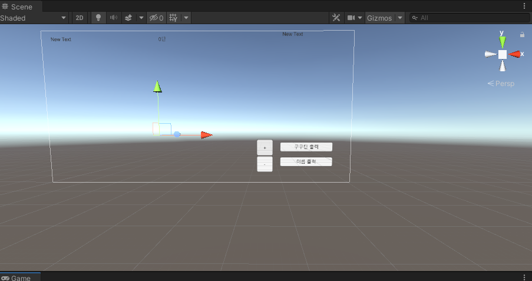

# 1주차 (유니티 기초 작업 세팅 기초 코드 함수)

<u>**유튜브 사진 참고해서 내용 정리 할것**</u>

**Scene : 개발자 화면(개발자만 볼수 있는 곳)**



**Game : 사용자 화면**


**오른쪽 위에 보면 Layers 옆에 std를 눌러서 2by3으로 바꾸고 다른이름으로 저장**

**Hierachy(하이라키?) : 오브젝트들을 관리하는 곳.(눈에 보이는 것들을 생성하기 위해서 꼭 필요함)**

**Hierachy위에 시작 버튼 누르면 사용자 화면을 실행 시킬수 있음 단, 시작하고나서 반드시 한번더 눌러서 초기화 해줘야함 초기화 하지 않고 다른 설정을 건드리면 그 이후부터는 저장이 안됨.**

**Assets : C#파일, 유니티 파일 자체 같은 것들을 관리하는 곳(코딩 관련 파일?)**

**Console : 코딩 컴파일 한 것을 출력하는 곳.**

**Inspector : Hierachy에 있는 것들의 상태를 설정 하는 곳.**

- **Tranform : 위치 설정하는 곳.**
- **Add Component : Assets에 있는 파일을 추가 할 수 있는 곳**
    
    **(원하고자 하는 행위를 코딩화 해서 추가하면 그 함수를 쓸 수 있음)** 
    
- **onClick : 마우스 왼쪽 버튼을 눌렀다 뗐을 때  수행하는 곳.**

**(+ 누르고 C#파일을 끌어다 옮기고 no fuction을 클릭해서 사용할 함수를 클릭한다.)**

**주의 해야할점 Hierachy와 Assets C#파일 명이 같아야 함.**

 **※ z축이 앞방향** 

**단축키 :** 

**마우스 드래그 누르면 공간이동 가능** 

**마우스 우클릭 누르면 서있는 상태에서 고개만 움직일수 있음.**

**마우스 좌클릭 누르면 물체 드래그 가능**

**q : 드래그 누르는거 없이 공간이동 가능**

**w : x, y, z축이 등장하면서 물체 위치 변경 가능 3개의 축이 있다고 해서 벡터3임(Vector3)**

**e : 물체의 방향을 다르게 할수 있음 이것 역시 x,y,z축이 존재.**

**r : 물체의 질량을 변경할 수 있음.**


**3D 오브젝트 : 구조물? 모형 같은 것들을 생성.**

**UI : 게임에서 뜨는 창 화면 뜨는 것들과 관련된 것들을 생성.** 

```
**유니티 용어   
   
    Debug.Log(); : printf와 같은 역할을 함.
  
    Random.Range(최소, 최대); // 최소 최대 랜덤으로 나오게 할수 있는 범위 지정 함수
 
    <u>GameObject 변수명</u> : Hierachy에 있는 모든 것들을 써서 행동 할수 있음?

    <u>Translate</u> : 유니티 이동 함수 
                       
ex) GameObject 변수명.변수명에 있는 Inspector안에 있는 큰 단락.Translate(Vector3.방향 * 속도(변수명 가능) * 현시점 시간?(<u>Time.deltaTime</u>)이건 외어야함. 이거 안쓰면 속도 엄청 빠름)
    
    Tostring() 함수 : 숫자를 문자로 변환하는 함수.

    증감자 연산 : ++, -- 변수명 앞뒤에 사용**
```

**void Start() = 최초 1회만 동작하는 함수, 0.01초**

**void Update() = 약 0.02초마다 프레임 단위로 동작 되는 함수**

 **1. **변수의 개념
변수란 개발자가 컴퓨터 메모리에 넣을 작은 영역의 정보들
게임을 실행하는 동안 여러 정보들을 주고 받으면서 동작
저장된 위치, 저장된 값, 저장된 값의 형식 등이 포함****

```
   
**2. **가장 많이 쓰이는 기본 변수 형식(자료형태, 데이터타입)
int | 간단한 정수
float | 실수
char | 문자
string | 따옴표로 묶은 문자 또는 문자열
bool | 참 과 거짓 판단 0(false) 1(true)**
3. **직렬화 기법 (유니티 기법)
-속성 부여 직렬화**
    : [ ] 대괄호 , 필요로 하는 변수명 윗줄에 
    [SerializeField]: 유니티 inspector에 새로운 칸 생성
    [Range(최소, 최대)] : 유니티 inspector에 범위 설정 가능
    -접근제어자 직렬화
    : private, public
    private 선언 시, 유니티에 안뜸.
    public 선언 시, 유니티에 뜸.
    
- 변수명은 동일한 이름으로 작명 불가능
   - 변수명 작성시 _(언더바) 사용 가능, 첫 문자 숫자 불가능
    
- 변수명 작성시 카멜기법 권장 (암묵적인 규칙), 기능에 맞는 이름으로 작명할 것을 추천

- ※ 변수명 첫글자는 소문자 (암묵적인 규칙), 함수는 첫 문자 대문자 권장

- <u>print 대신 Debug.Log(변수명);을 사용</u>

- 접근제어자 private 생략 가능(default로 되어있음), 필요에 따라서 public, private를 쓰기!
ex) (private) int number = 2;

public으로 사용 할 시 <u>유니티에서 설정하는게 우선순위</u>로 되어있고, private를 사용시 <u>코드 내용 우선 순위</u>로 되어있음.(<u>유니티에서 건들지 못함</u>)

- 클래스 내부와 클래스 내부에 있는 함수 내부에 동일한 이름의 변수 선언 가능하지만 클래스 내부끼리 에서의 동일한 이름은 중복 X, 함수 내부 포함. 단, 구분은 알아서 해야함.

우선 순위는 함수 내부임. 클래스 내부의 동일 변수명을 쓰고 싶으면 변수명 앞에 this.를 붙이면 됨 ex) this.number 면 2를 쓰고 number 면 999를 씀.****
```

**< 함수 >
정의 : 특정한 작업을 정의하여 필요할 때마다 호출해서 사용되는 코드 묶음 들**

```
    **- 함수 정의 최소 요건 -
1) 리턴(return) : void를 제외한 나머지 자료형에 붙이면 됨.(int , folat, string, bool 등)
반환할 데이터가 정해져 있지 않다면 void형으로 명시한다.(void에도 쓸쑤는 있지만 결과를 반환 하면 오류가 뜸.)
    
2) 한쌍의 괄호, 한쌍의 중괄호 필요 -> 함수의 모든 기능은 중괄호 안에 작성 클래스 내부에 정의

    ex) int AddTwoNumber()
            {
                return 0;
            }
    - 동일한 함수명으로 사용 불가능 하지만 매개변수 수량을 다르게 하면 동일한 이름 가능함.(오버로드)
    
   ex) int AddTwoNumber(int num)
            {
                return num;
            }**

```

```
    ****
```

```
    ****
```

