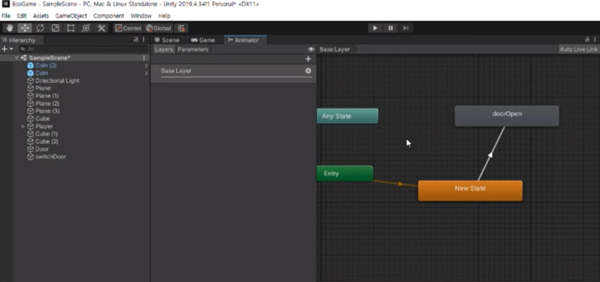

# 유니티2 다른 강사님(8월 코인 8/11 , 8/18)

```
    **코인 회전 시키는 법 업데이트 구간에 
    this.transform.Rotate(0, 100*Time.deltaTime, 0);
    여기서 100 곱 델타 타임은 1분에 100번 회전 하는것? 
    
    프리팹 : 하이라키에 있는 오브젝트?를 프로젝트에 끌어다 놓으면 프리팹이 생성됨 이 프리팹은 하이라키에 저장되어있는 것을 고유의 오브젝트 느낌으로 저장되는 느낌.
    중력(rigidbody) 적용은 언제하나? -> 점프할 때?  
    
    GetComponent<가져올 컴포넌트 이름>() : 자기 자신의 게임오브젝트의 컴포넌트를 가져 오는 것
    ex) transComp = GetComponent<Transform>(); => 트랜스폼 컴포넌트를 가져와서 transComp에 저장함. 
    Floor Physic Material : 바닥에 좀더 튀게 하는? 그런 것. 적용하는 방법은 그거를 끌어서 매쉬 콜라이더의 Material 부분에 놓으면 됨. ex) 스키 바닥? 같은거
    
    GetAxis -> 유니티 에딧 프로젝트 세팅 인풋 매니저에서 확인 할수 있음.
    키 입력 받는 법 : horiz = <u>Input.GetAxis("Horizontal");</u>
    이동
    Transalte()
    회전
    Rotate()
    점프
    AddForce(Vector3.up * jumPowerFactor) 
    코인 먹었을때 삭제 하는 거(충돌 체크) => 1. 특정 태그 설정 2. 플레이어 컨트롤러에 OntriggerEnter 함수 적용 isTrigger를 두개의 객체에 체크해도 되는데 둘다 안해버리면 물체가 팅김. 최소 하나는 체크를 해야 충돌 체크(물체 통과?)가 됨. 
    OnTriggerEnter
    {
	    if(other.gameobject.tag == 'coin'(1번 태그 설정 이름) 
	    {
		    제거
		    Destroy(other.gameobject);
	    }
    }
    게임 쿼드트리 : 게임 엔진에서 많이? 나옴. 평면에서 땅바닥 지형 할때? 쓰임
    게임 옥트리 : 상하 공간에서 쓸 때(ex : 빌딩) 쓰임.
    bsp : 랜덤맵 생성 알고리즘
     나중에 공부 해보면 좋을듯
 
 8/18 두개의 코인을 먹었을때 버튼을 누르면 문이 열림.
 
 1. 문 애니메이션 생성 방법
 어셋츠에 마우스 우클릭후 애니메이션 생성하고 애니메이션 하고 싶은 객체를 클릭한다. 
 그리고 create 누르면 저장하고 싶은 곳에 저장.
 add property 클릭하고 트랜스폼 포지션 클릭해서 시간 초를 끝까지 당기고 문을 위로 올린다. 그렇게 하면 문을 여는 애니메이션 저장됨.
 마지막으로 저장된 애니메이션을 끌어서 움직이고픈 객체에다 끌어서 놓으면 됨.  
루핑 : 처음부터 끝까지 반복 하는것(ex. 문 열리는게 계속 반복됨) 
루핑 끄는 방법 : 끄고싶은 애니메이션 클릭해서 루프타인을 체크해제 하면됨. 
 Animator : 전반적으로 애니메이션을 관리하는 곳? 애니메이션 동작 후 추가 연계 동작 가능 
 아래 애니메이터 처럼 설정 
 그리고 아래 뉴 스테이트 와 도어 오픈 사이의 화살표를 클릭 후 컨디션 + 클릭 해서 조건 걸기. 조건에는 4가지 유형이 있음(float, int, bool, trigger) 
 플레이어 컨트롤러 C# 파일에 들어가서 조건에 걸 코인 개수 변수와 온트리거 함수 안에 코인 개수 증가를 시키는 코드를 추가한다. 
 public Gameobject doorToOpen;
 Animator doorAni; 코드 추가 하고 하이라키에 있는 문을 끌어서 doorToOpen에 넣는다.
 void Start에 doorToOpen의 컴포넌트를 doorAni에 넣는다. 
 
 그리고 발판을 밟았을 때의 태그(key)의 충돌이 일어날 때 코인 개수가 충족되면 
 doorAni.SetTrigger("open"); 코드 추가 
 
 
 조건 충족해서 주황버튼 밟았을 때 초록 버튼으로 바꾸는 방법
	 위에 코드를 추가 했을때 key부분에 other.gameobject.GetComponent<Renderer>().material.color = Color.green; 추가
	 
 코인 먹을 때 소리 내는 법
 코인 객체 클릭 하고 
 1. 스크립트에 
 private AudioSource audio;
 public AudioClip coinSound; 코드 추가
 void Start에 
 this.audio = this.gameObject.AddComponent<AudioSource>();
 this.audio.clip = coinSound;
 this.audio.loop = false; 추가하고 에디터에 가서 플레이어에 있는 코인 사운드에 음원을 끌어다 놓으면 됨.
 마지막으로 코인과 충돌이 일어나는 코드(조건)에 this.audio.Play(); 코드 추가 
 이 방법이 스크립트에 추가하는 방법 이고 
 다른 방법은 에디터에 Audio Source 컴포넌트를 추가 하는 방법이 있다. 이건 취향에 따라 하면 됨.** 

```



```
       
 **UI생성 방법 
 하이라키에 우클릭 UI -> canvus 클릭
 우클릭 UI -> 꾸미고 싶은 대로 꾸미기(버튼, 텍스트 등등)
 캔버스의 rect Transform x좌표는 가운데에서 오른쪽까지의 크기 임 y좌표도 x좌표와 같음.
 그리고 왼쪽 박스 클릭 하고 아래 사진 처럼 클릭 하면 좌측에서 x,y 계산됨.
 그리고 캔버스 랜더러 체크
Update에 GameObject.Find("Canvus").transform.Find("텍스트 이름").gameobject.SetActive(true); 코드 추가.
첫번째 find는 하이라키의 모든 것들 중에 ()안에 있는걸 찾는 것이고, 그다음으로 ()안에 있는 구성요소 중 활성화 되어있는 요소를 찾고, 마지막으로 setActive는 체크박스 비/활성화 시키는 것.
그리고 create emtpy를 해서 그 객체에 스크립트 추가해서 
public void startGame()
{
	//새로운 scene로딩
			SceneManager.LoadScene("GameScen");
}
public void endGame()
{
			//게임 종료
			Application.Quit();
} 코드 추가
그리고 quitButton에서 On Click()함수 추가해서 Uimgr을 끌어다 놓고 endgame()를 선택함.

그리고 
using UnityEngine UI;
public Text scoreText; 추가

그리고
충돌체크 부분에서 코인일때 그 안에 scoreText.text = "Score : " + coinCount.Tostring(); 코드 추가

로비 화면 만드는법?
파일 -> 뉴 씬 -> 세이브 애즈 ->원하는 파일 이름 
UI -> 캔버스 -> 꾸미기 
로비화면 씬에 있는 스크립트에
 SceneManager.LoadScene("로비씬이름 또는 저장 순서 번호"); 추가
그리고 빌드 세팅에서 애드 오픈 씬 클릭해서 로비 화면 씬 추가
<u>빌드 세팅에 번호가 순서 번호임!</u>

게임 출시?하는 방법
파일의 빌드 세팅에서 PC면 해당하는 거에 클릭후 Add Open Scene을 눌러서 추가 후, 기호에 맞게 저장.
저장된 것을 실행해서 확인.**

```


